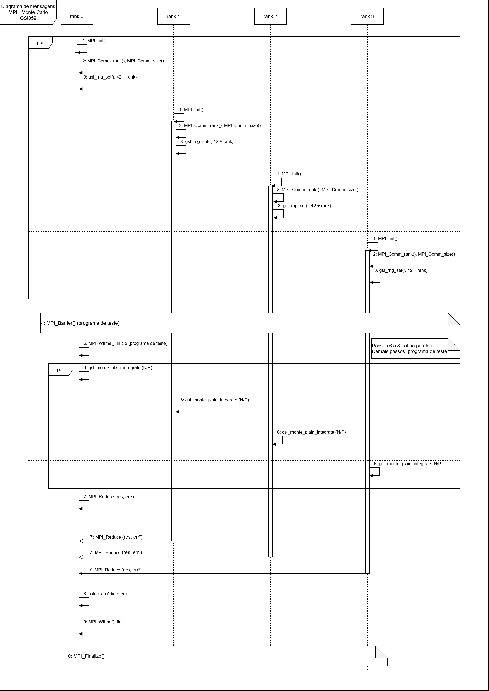

# **Explicação do diagrama de sequência que ilustra a nossa paralelização utilizando MPI para o Monte Carlo Simples da GSL**

   
   
**Escopo de cálculo**

Primeiramente, é importante ressaltar que a integral é a área embaixo de uma curva. Com isso, esse trabalho calcula a área embaixo da curva f(x) = 1 / (1+ x²), com x no intervalo de 0 a 1, cujo valor exato corresponde a π/4, isto é, 0,785398.

Esse valor serve de referência para conferir os resultados do Monte Carlo, a fim de confirmar se estão próximos do correto.

**Explicação breve de Monte Carlo**

Para o cálculo da forma geométrica retângulo, realiza-se a operação largura vezes altura. Porém, como a curva não é reta, utiliza-se Monte Carlo, com o intuito de descobrir a altura média dela através de sorteio. Para tal, tem-se o seguinte passo a passo:

1. Sorteia um valor de x entre 0 e 1 (em que cada sorteio é denominado de "ponto");

2. Calcula a altura da curva no ponto sorteado, f(x);

3. Repete milhões de vezes e, então, tira a média das alturas;

4. Multiplica a média pela largura do intervalo, sendo que, em nosso escopo, é 1. O resultado dessa operação corresponde à área almejada.

Com apenas 3 pontos, x = 0,2 dá altura 0,96; x = 0,7 dá 0,67; x = 0,5 dá 0,80. A média é 0,81, valor próximo de 0,785. Com milhões de pontos, o resultado se aproxima muito do exato. Quanto mais pontos são usados, mais os sorteios se equilibram. Os que caem em pontos que puxam a média para cima, que podemos chamar de "azarados", são compensados pelos que a puxam para baixo. A *GNU Scientific Library* (GSL), além de devolver o resultado, traz consigo a estimativa do erro, identificado como sigma. Para reduzir esse erro pela metade, são necessários 4 vezes mais pontos.

**Por que paralelizar?**

Cada ponto é sorteado e calculado sem ter a dependência de nenhum outro. Logo, realiza-se a divisão dos N pontos entre P processos, em que cada processo calcula N/P pontos, todos simultaneamente, para, no fim, juntar os resultados. Como já visto em sala de aula, aplica-se uma mesma operação para pontos diferentes, conceito conhecido como paralelismo de dados.

**O uso da semente**

O computador gera números pseudoaleatórios a partir de um número inicial, que é a semente (*seed*). Assim, a mesma semente gera deterministicamente a mesma sequência de números. Tendo isso em vista, caso todos os processos utilizassem a mesma semente, todos fariam o sorteio dos mesmos pontos, obtendo um trabalho repetido. Desse modo, definiu-se que cada processo utiliza uma semente distinta, igual a 42 + o rank.

A semente é definida depois que o processo descobre o seu rank, com o MPI_Comm_rank(). Seguimos o padrão usado pelo professor na aula (semente fixa + número da thread), o que torna os resultados reprodutíveis. Para variar, a semente base pode ser trocada pela variável de ambiente GSL_RNG_SEED, da própria GSL.

**Rotina paralela e programa de teste**

A versão MPI é dividida em duas partes. A rotina paralela faz apenas o cálculo: cada processo chama a gsl_monte_plain_integrate com N/P pontos, os resultados são combinados com o MPI_Reduce e o rank 0 calcula a média e o erro. O programa de teste, que é o main, chama essa rotina e faz a barreira e a medição do tempo em volta dela, assim como a versão serial faz com a gsl_monte_plain_integrate. Dessa forma, quem quiser apenas calcular a integral não precisa da barreira nem da medição.

**Passo a passo do diagrama**

O diagrama evidencia 4 processos, do rank 0 ao 3, com o tempo correndo de cima para baixo. Os passos com o mesmo número acontecem ao mesmo tempo em todos os processos, e o fragmento par indica que eles são executados em paralelo, sem ordem definida entre os ranks.

1. **MPI_Init:** cada processo inicia o ambiente MPI.
2. **MPI_Comm_rank e MPI_Comm_size:** cada processo descobre o seu número (rank) e o total de processos (P).
3. **Semente:** cada processo define a sua semente, igual a 42 + rank.
4. **MPI_Barrier:** os processos esperam todos os demais chegarem, para iniciarem juntos e garantir uma medição de tempo justa. Como a barreira acontece antes do MPI_Wtime de início, o custo dela não entra no tempo medido.
5. **MPI_Wtime, início:** o rank 0 marca o horário em que começou.
6. **gsl_monte_plain_integrate (N/P):** cada processo calcula os seus N/P pontos. Aqui é onde se realiza a parte paralela.
7. **MPI_Reduce:** cada processo envia o seu resultado e o seu erro ao quadrado ao rank 0, que soma todos, incluindo os seus próprios. Essa é a única comunicação do programa.
8. **Calcula média e erro:** o resultado final é a soma dos resultados dividida por P. O erro final é a raiz da soma dos erros ao quadrado, dividida por P. Os erros não são somados diretamente porque se compensam em parte. Somá-los direto suporia que todos erraram para o mesmo lado, o que exageraria o erro final. Assim, a versão paralela tem o mesmo erro da serial, já que o total de pontos é o mesmo.
9. **MPI_Wtime, fim:** o rank 0 marca o horário de fim. O tempo entre os passos 5 e 9 é usado para calcular o speedup, S = T1/Tp.
10. **MPI_Finalize:** todos encerram o MPI.

Os passos 6 a 8 formam a rotina paralela. Os demais pertencem ao programa de teste.

As notações utilizadas, conforme padrão UML e documentação da IBM (https://www.ibm.com/docs/pt-br/rsas/7.5.0?topic=diagrams-messages-in-uml), foram:

* **Setas de ponta cheia:** para representar as mensagens de um processo para ele mesmo, sendo operações locais.
* **Setas de ponta aberta:** para representar as mensagens assíncronas do Reduce, em que o processo envia o resultado e segue, sem esperar resposta.
* **Fragmento par:** retângulo que indica que os trechos dentro dele são executados em paralelo, sem ordem definida entre os ranks.
* **Notas:** retângulos com o canto dobrado, usados para a barreira, o encerramento e a indicação da rotina paralela.