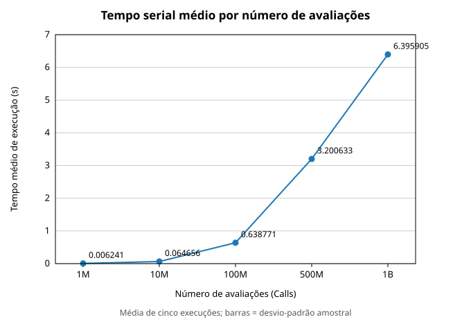
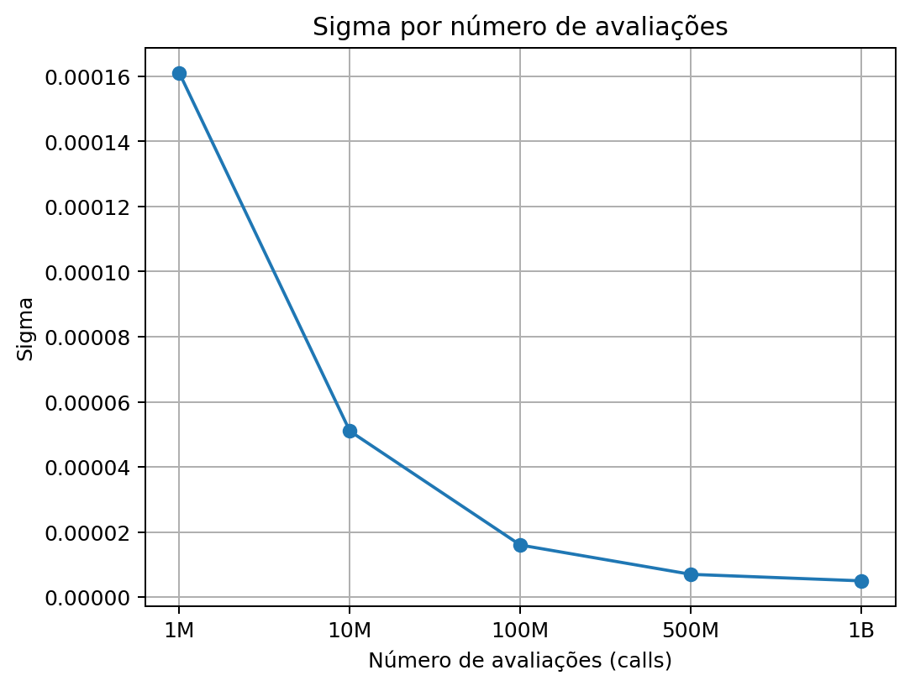

# Testes e desempenho – Versão serial (GSL Monte Carlo Plain)

Caracterização experimental da versão serial ([serial/serial.c](../serial/serial.c)), que servirá de referência (**T₁**) para a comparação com a versão MPI.

## 1. Configuração do experimento

| Item | Valor |
| --- | --- |
| Rotina | `gsl_monte_plain_integrate` (GSL) |
| Função | f(x) = 1 / (1 + x²) |
| Intervalo | [0, 1] (1 dimensão) |
| Valor exato | π/4 ≈ 0,7853981634 |
| Número de avaliações (`calls`) | 1 M, 10 M, 100 M, 500 M, 1 bi |
| Repetições por configuração | 5 |
| Medição de tempo | `clock()` (tempo de CPU) |
| Gerador aleatório | padrão da GSL (`gsl_rng_default`, semente padrão) |

Métricas registradas por execução: `tempo`, `result` (estimativa da integral) e `sigma` (erro-padrão estimado). O erro absoluto é `|result − π/4|`.

## Ambiente de execução

### Hardware

| Componente | Especificação |
|---|---|
| Processador | Intel Core i5-13420H – 13ª geração |
| Fabricante | Intel |
| Núcleos físicos | 6 |
| Threads lógicas | 12 |
| Cache L1d | 288 KiB |
| Cache L1i | 192 KiB |
| Cache L2 | 7,5 MiB |
| Cache L3 | 12 MiB |
| Memória RAM disponível no WSL | 15 GiB |
| Swap | 4 GiB |
| Arquitetura | x86_64 |

### Software

| Componente | Especificação |
|---|---|
| Sistema operacional | Ubuntu 24.04.5 LTS |
| Ambiente de execução | WSL2 |
| Compilador | GCC 13.3.0 |
| Biblioteca matemática | GNU Scientific Library (GSL) 2.7.1 |
| Otimização | `-O2` |

Arquivos de origem dos dados:

- [dados_obtidos.xlsx](../dados_obtidos.xlsx): dados brutos das 5 execuções.
- [resultado_obtido_2.ods](../resultado_obtido_2.ods): médias e desvios-padrão.

## 2. Tempos de execução (s)

| Calls | Exec. 1 | Exec. 2 | Exec. 3 | Exec. 4 | Exec. 5 |
| ---: | ---: | ---: | ---: | ---: | ---: |
| 1.000.000 | 0,006221 | 0,006253 | 0,006243 | 0,006284 | 0,006204 |
| 10.000.000 | 0,064689 | 0,066508 | 0,064293 | 0,062524 | 0,065265 |
| 100.000.000 | 0,632237 | 0,637408 | 0,639578 | 0,636225 | 0,648405 |
| 500.000.000 | 3,236919 | 3,159761 | 3,183639 | 3,175849 | 3,246996 |
| 1.000.000.000 | 6,353471 | 6,298891 | 6,462179 | 6,392334 | 6,472648 |

## 3. Estatísticas (valores de T₁)

Desvio-padrão amostral (n − 1 = 4); CV = desvio / média.

| Calls | **T₁ média (s)** | Desvio-padrão (s) | CV | Mín (s) | Máx (s) | Vazão (M calls/s) |
| ---: | ---: | ---: | ---: | ---: | ---: | ---: |
| 1.000.000 | **0,006241** | 0,000031 | 0,49 % | 0,006204 | 0,006284 | 160,2 |
| 10.000.000 | **0,064656** | 0,001456 | 2,25 % | 0,062524 | 0,066508 | 154,7 |
| 100.000.000 | **0,638771** | 0,006010 | 0,94 % | 0,632237 | 0,648405 | 156,6 |
| 500.000.000 | **3,200633** | 0,038858 | 1,21 % | 3,159761 | 3,246996 | 156,2 |
| 1.000.000.000 | **6,395905** | 0,073326 | 1,15 % | 6,298891 | 6,472648 | 156,4 |

Crescimento do tempo médio entre configurações consecutivas:

| Transição | Fator de `calls` | Fator de tempo |
| --- | ---: | ---: |
| 1 M → 10 M | 10× | 10,36× |
| 10 M → 100 M | 10× | 9,88× |
| 100 M → 500 M | 5× | 5,01× |
| 500 M → 1 bi | 2× | 2,00× |

O custo é praticamente linear em `calls` (~156 M avaliações/s) e as medições são estáveis (CV ≤ 2,25 %).

## 4. Precisão da estimativa

`result` e `sigma` são idênticos nas 5 repetições (semente padrão fixa da GSL), portanto há um único valor por configuração.

| Calls | result | sigma | Erro absoluto | Erro / sigma |
| ---: | ---: | ---: | ---: | ---: |
| 1.000.000 | 0,785488 | 0,000161 | 0,000090 | 0,56 |
| 10.000.000 | 0,785403 | 0,000051 | 0,000005 | 0,09 |
| 100.000.000 | 0,785382 | 0,000016 | 0,000016 | 1,0 |
| 500.000.000 | 0,785388 | 0,000007 | 0,000011 | ~1,5 |
| 1.000.000.000 | 0,785395 | 0,000005 | 0,000003 | 0,58 |

- `sigma` cai aproximadamente como 1/√N (cada ×10 em `calls` reduz sigma ≈ ×3,2).
- Todas as estimativas ficam a menos de 2 sigma do valor exato, ou seja, são estatisticamente coerentes.

## 5. Uso na comparação com MPI

Com P processos e tempo T_P para o **mesmo** número total de `calls`:

- **Speedup:** S(P) = T₁ / T_P
- **Eficiência:** E(P) = S(P) / P

Speedup e eficiência **ainda não foram calculados**, pois a versão MPI está pendente.

## 6. Gráficos

### 6.1 Tempo médio por número de avaliações

Reproduz o gráfico de [resultado_obtido_2.ods](../resultado_obtido_2.ods), construído a partir das médias T₁ da seção 3 (as barras indicam o desvio-padrão, quase imperceptível na escala). Mostra o crescimento linear do tempo com `calls`.

### 6.2 Sigma por número de avaliações

Gráfico da [analise_inicial.docx](../analise_inicial.docx) (Figura 2). Seus valores (0,000161; 0,000051; 0,000016; 0,000007; 0,000005) coincidem com a tabela da seção 4 e com o `.xlsx`, e a queda acompanha σ ∝ 1/√N.

## 7. Limitações e próximos passos

- Sem variação de `result`/`sigma` entre repetições, pois a semente é fixa; a variabilidade medida refere-se só ao tempo.
- `clock()` mede CPU; para comparar com MPI, usar tempo real (`clock_gettime(CLOCK_MONOTONIC)` no serial e `MPI_Wtime()` no MPI) e reavaliar T₁.
- Executar a versão MPI com os mesmos `calls` e calcular S(P) e E(P).

