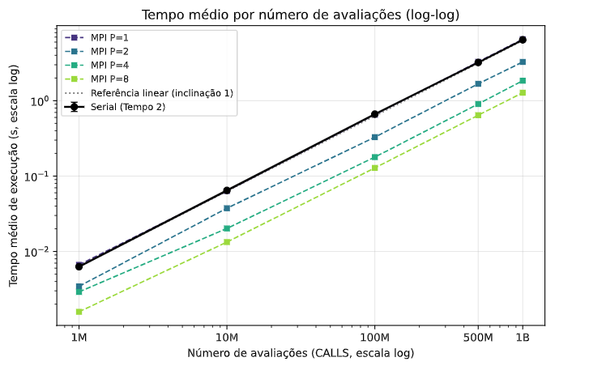
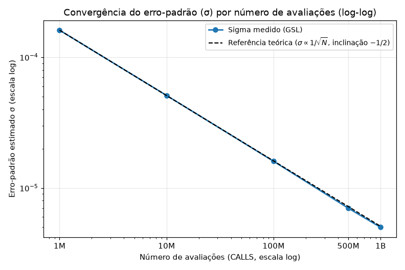
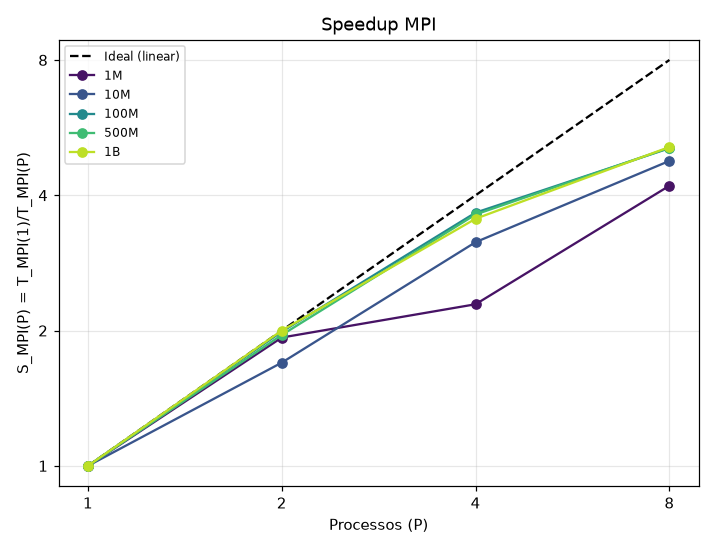
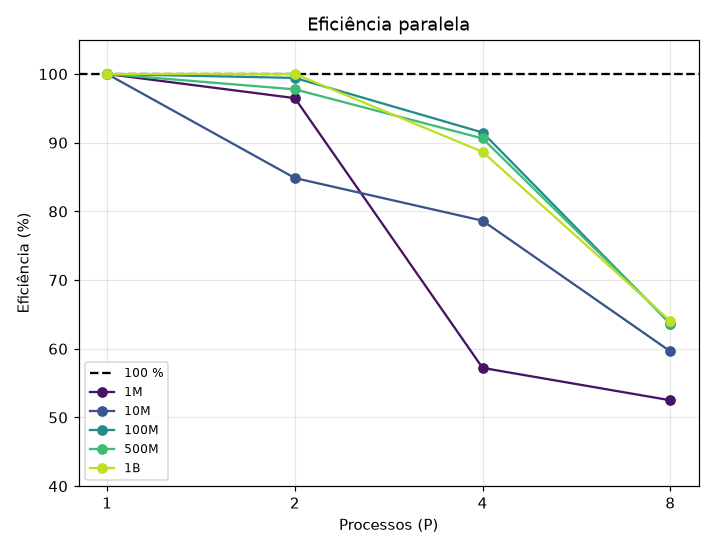
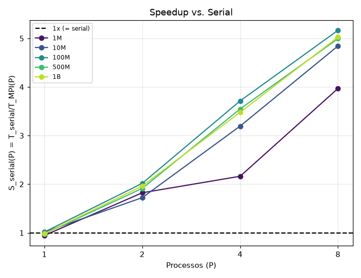

# Testes e desempenho – Versão Serial vs. MPI (GSL Monte Carlo Plain)

Caracterização experimental comparativa entre a versão serial ([serial/serial.c](../serial/serial.c)) e a implementação paralela com MPI ([mpi/monte_carlo_mpi.c](../mpi/monte_carlo_mpi.c)), a partir dos dados consolidados em [dados_final.xlsx](../dados_final.xlsx).

A análise estatística aprofundada, o teste de Welch e as recomendações metodológicas completas estão em [docs/analise_desempenho_v2.md](../docs/analise_desempenho_v2.md).

## 1. Configuração do experimento

| Item | Versão Serial | Versão MPI |
| --- | --- | --- |
| Rotina | `gsl_monte_plain_integrate` (GSL) | `gsl_monte_plain_integrate` (GSL) + `MPI_Reduce` |
| Função | f(x) = 1 / (1 + x²) | f(x) = 1 / (1 + x²) |
| Intervalo | [0, 1] (1 dimensão) | [0, 1] (1 dimensão) |
| Valor exato | π/4 ≈ 0,7853981634 | π/4 ≈ 0,7853981634 |
| Número de avaliações (`calls`) | 1 M, 10 M, 100 M, 500 M, 1 bi | 1 M, 10 M, 100 M, 500 M, 1 bi (`calls / P` por processo) |
| Processos (`P`) | 1 | 1, 2, 4, 8 (via [mpi/verifica.sh](../mpi/verifica.sh)) |
| Repetições por configuração | 5 | 5 |
| Medição de tempo | `clock_gettime(CLOCK_MONOTONIC)` (código atual) | `MPI_Wtime()` no rank 0 (após `MPI_Barrier`, sem `MPI_Init`/`Finalize`) |
| Compilação | `gcc -O2 -Wall serial.c -o serial -lgsl -lgslcblas -lm` | `mpicc -O2 -Wall -Wextra monte_carlo_mpi.c ... -lgsl -lgslcblas -lm` |
| Gerador aleatório | `gsl_rng_default` (semente padrão) | `gsl_rng_default` (semente `42 + rank`) |

Métricas registradas por execução: `tempo`, `result` (estimativa da integral) e `sigma` (erro-padrão estimado). O erro absoluto é `|result − π/4|`.

## Ambiente de execução

### Hardware

| Componente | Especificação |
|---|---|
| Processador | Intel Core i5-13420H – 13ª geração |
| Fabricante | Intel |
| Núcleos físicos | 6 (reportados no WSL; ver nota sobre P/E-cores em `docs/analise_desempenho_v2.md`) |
| Threads lógicas | 12 |
| Cache L1d | 288 KiB |
| Cache L1i | 192 KiB |
| Cache L2 | 7,5 MiB |
| Cache L3 | 12 MiB |
| Memória RAM disponível no WSL | 15 GiB |
| Swap | 4 GiB |
| Arquitetura | x86_64 |

### Software

| Componente | Especificação |
|---|---|
| Sistema operacional | Ubuntu 24.04.5 LTS |
| Ambiente de execução | WSL2 |
| Compilador | GCC 13.3.0 |
| Biblioteca matemática | GNU Scientific Library (GSL) 2.7.1 |
| Otimização | `-O2` |

Arquivo de origem dos dados: [dados_final.xlsx](../dados_final.xlsx) (abas `Serial`, `MPI` e `SpeedUp`).

## 2. Resultados da versão serial (referência T₁)

A aba `Serial` de [dados_final.xlsx](../dados_final.xlsx) registra duas séries: **Tempo 1** (medição inicial) e **Tempo 2** (medição de referência correspondente à versão atual de [serial/serial.c](../serial/serial.c)). Abaixo estão os dados extraídos da série oficial (**Tempo 2**, `Serial!K30:Q34`):

### 2.1 Tempos individuais e estatísticas (Tempo 2)

| Calls | Exec. 1 | Exec. 2 | Exec. 3 | Exec. 4 | Exec. 5 | **T₁ média (s)** | Desvio-padrão (s) | CV | Vazão (M calls/s) |
| ---: | ---: | ---: | ---: | ---: | ---: | ---: | ---: | ---: | ---: |
| 1.000.000 | 0,006249 | 0,006295 | 0,006375 | 0,006223 | 0,006259 | **0,0062802** | 0,000059 | 0,94 % | 159,2 |
| 10.000.000 | 0,065545 | 0,065647 | 0,063172 | 0,065199 | 0,063040 | **0,0645206** | 0,001303 | 2,02 % | 155,0 |
| 100.000.000 | 0,656971 | 0,660835 | 0,673669 | 0,669534 | 0,654567 | **0,6631152** | 0,008195 | 1,24 % | 150,8 |
| 500.000.000 | 3,215754 | 3,190866 | 3,217292 | 3,248307 | 3,167690 | **3,2079818** | 0,030371 | 0,95 % | 155,9 |
| 1.000.000.000 | 6,508334 | 6,371469 | 6,389957 | 6,355370 | 6,472054 | **6,4194368** | 0,066981 | 1,04 % | 155,8 |

Crescimento do tempo médio entre configurações consecutivas (Tempo 2):

| Transição | Fator de `calls` | Fator de tempo |
| --- | ---: | ---: |
| 1 M → 10 M | 10× | 10,27× |
| 10 M → 100 M | 10× | 10,28× |
| 100 M → 500 M | 5× | 4,84× |
| 500 M → 1 bi | 2× | 2,00× |

O custo é linear em `calls` (~151–159 M avaliações/s) e as medições seriais são estáveis (CV ≤ 2,02 %). *(Nota: na série anterior Tempo 1, as médias eram 0,006241 s; 0,064656 s; 0,638771 s; 3,200633 s e 6,395905 s — diferença ≤ 0,63 %, exceto em 100 M onde Tempo 2 é 3,81 % maior.)*

### 2.2 Precisão da estimativa serial

`result` e `sigma` são idênticos nas 5 repetições (semente padrão fixa da GSL), portanto há um único valor por configuração (`Serial!C2:C27`):

| Calls | result | sigma | Erro absoluto | Erro / sigma |
| ---: | ---: | ---: | ---: | ---: |
| 1.000.000 | 0,785488 | 0,000161 | 0,000090 | 0,56 |
| 10.000.000 | 0,785403 | 0,000051 | 0,000005 | 0,09 |
| 100.000.000 | 0,785382 | 0,000016 | 0,000016 | 1,00 |
| 500.000.000 | 0,785388 | 0,000007 | 0,000011 | ~1,5 |
| 1.000.000.000 | 0,785395 | 0,000005 | 0,000003 | 0,58 |

- `sigma` cai aproximadamente como `1/√N` (cada ×10 em `calls` reduz sigma em ≈ ×3,16).
- Todas as estimativas ficam a menos de 2σ do valor exato.

## 3. Resultados da versão MPI (abas `MPI` e `SpeedUp`)

### 3.1 Tempos médios, variabilidade, Speedup e Eficiência

Valores extraídos de `dados_final.xlsx` (aba `SpeedUp!B3:N26`, com **Speedup vs. Serial** calculado sobre o **Tempo 2** oficial de `Serial!K30:O34`):

- **Speedup MPI:** `S_MPI(P) = T_MPI(1) / T_MPI(P)`
- **Eficiência paralela:** `E(P) = [S_MPI(P) / P] × 100`
- **Speedup vs. Serial:** `S_serial(P) = T_serial(Tempo 2) / T_MPI(P)`

| Calls | P | Média (s) | Desvio-padrão (s) | CV | Speedup MPI | Eficiência | Speedup vs. Serial | Vazão (M calls/s) |
| ---: | ---: | ---: | ---: | ---: | ---: | ---: | ---: | ---: |
| 1.000.000 | 1 | 0,0066454 | 0,000385 | 5,79 % | 1,000 | 100,0 % | 0,945 | 150,5 |
|  | 2 | 0,0034436 | 0,000306 | 8,88 % | 1,930 | 96,5 % | 1,824 | 290,4 |
|  | 4 | 0,0029038 | 0,001587 | 54,66 % | 2,289 | 57,2 % | 2,163 | 344,4 |
|  | 8 | 0,0015822 | 0,000591 | 37,33 % | 4,200 | 52,5 % | 3,969 | 632,0 |
| 10.000.000 | 1 | 0,0635332 | 0,000952 | 1,50 % | 1,000 | 100,0 % | 1,016 | 157,4 |
|  | 2 | 0,0374358 | 0,006130 | 16,37 % | 1,697 | 84,9 % | 1,723 | 267,1 |
|  | 4 | 0,0201968 | 0,000952 | 4,71 % | 3,146 | 78,6 % | 3,195 | 495,1 |
|  | 8 | 0,0133204 | 0,001365 | 10,25 % | 4,770 | 59,6 % | 4,844 | 750,7 |
| 100.000.000 | 1 | 0,6534248 | 0,001529 | 0,23 % | 1,000 | 100,0 % | 1,015 | 153,0 |
|  | 2 | 0,3285842 | 0,004185 | 1,27 % | 1,989 | 99,4 % | 2,018 | 304,3 |
|  | 4 | 0,1785646 | 0,009790 | 5,48 % | 3,659 | 91,5 % | 3,714 | 560,0 |
|  | 8 | 0,1283748 | 0,009408 | 7,33 % | 5,090 | 63,6 % | 5,165 | 779,0 |
| 500.000.000 | 1 | 3,2778154 | 0,017237 | 0,53 % | 1,000 | 100,0 % | 0,979 | 152,5 |
|  | 2 | 1,6763514 | 0,036803 | 2,20 % | 1,955 | 97,8 % | 1,914 | 298,3 |
|  | 4 | 0,9042620 | 0,033418 | 3,70 % | 3,625 | 90,6 % | 3,548 | 552,9 |
|  | 8 | 0,6423622 | 0,017514 | 2,73 % | 5,103 | 63,8 % | 4,994 | 778,4 |
| 1.000.000.000 | 1 | 6,5440496 | 0,079136 | 1,21 % | 1,000 | 100,0 % | 0,981 | 152,8 |
|  | 2 | 3,2716714 | 0,006573 | 0,20 % | 2,000 | 100,0 % | 1,962 | 305,7 |
|  | 4 | 1,8449988 | 0,048156 | 2,61 % | 3,547 | 88,7 % | 3,479 | 542,0 |
|  | 8 | 1,2775698 | 0,020678 | 1,62 % | 5,122 | 64,0 % | 5,025 | 782,7 |

### 3.2 Síntese do ganho vs. Serial (Tempo 2)

| Calls | Serial (s) | MPI P=1 | MPI P=2 | MPI P=4 | MPI P=8 |
| ---: | ---: | ---: | ---: | ---: | ---: |
| 1.000.000 | 0,0062802 | 0,945x | 1,824x | 2,163x | 3,969x |
| 10.000.000 | 0,0645206 | 1,016x | 1,723x | 3,195x | 4,844x |
| 100.000.000 | 0,6631152 | 1,015x | 2,018x | 3,714x | 5,165x |
| 500.000.000 | 3,2079818 | 0,979x | 1,914x | 3,548x | 4,994x |
| 1.000.000.000 | 6,4194368 | 0,981x | 1,962x | 3,479x | 5,025x |

### 3.3 Precisão numérica da versão MPI (aba `MPI`)

Como cada rank recebe uma semente independente (`42 + rank`) e o total de amostras `calls` é preservado, `sigma` permanece igual ao da versão serial para todo `P` e todas as 20 configurações ficam abaixo de `2σ` do valor exato (`π/4`):

| Calls | P | result | sigma | Status (aba `MPI`) |
| ---: | ---: | ---: | ---: | --- |
| 1.000.000 | 1 | 0,785297 | 0,000161 | OK (0,63 σ) |
|  | 2 | 0,785409 | 0,000161 | OK (0,07 σ) |
|  | 4 | 0,785311 | 0,000161 | OK (0,54 σ) |
|  | 8 | 0,785360 | 0,000161 | OK (0,24 σ) |
| 10.000.000 | 1 | 0,785409 | 0,000051 | OK (0,21 σ) |
|  | 2 | 0,785404 | 0,000051 | OK (0,11 σ) |
|  | 4 | 0,785338 | 0,000051 | OK (1,18 σ) |
|  | 8 | 0,785390 | 0,000051 | OK (0,16 σ) |
| 100.000.000 | 1 | 0,785412 | 0,000016 | OK (0,86 σ) |
|  | 2 | 0,785377 | 0,000016 | OK (1,32 σ) |
|  | 4 | 0,785392 | 0,000016 | OK (0,39 σ) |
|  | 8 | 0,785426 | 0,000016 | OK (1,74 σ) |
| 500.000.000 | 1 | 0,785401 | 0,000007 | OK (0,41 σ) |
|  | 2 | 0,785401 | 0,000007 | OK (0,41 σ) |
|  | 4 | 0,785401 | 0,000007 | OK (0,41 σ) |
|  | 8 | 0,785395 | 0,000007 | OK (0,45 σ) |
| 1.000.000.000 | 1 | 0,785403 | 0,000005 | OK (0,97 σ) |
|  | 2 | 0,785405 | 0,000005 | OK (1,37 σ) |
|  | 4 | 0,785405 | 0,000005 | OK (1,37 σ) |
|  | 8 | 0,785402 | 0,000005 | OK (0,77 σ) |

*(Nota: na aba `MPI!K26:K29`, os valores de 100 M aparecem multiplicados por 10⁶ por formatação; acima estão normalizados para a escala `[0, 1]`.)*

## 4. Análise dos resultados

1. **Ganho sobre o serial:** nas cargas maiores (100 M a 1 bi), o MPI com `P = 8` atinge **≈ 5,0× a 5,2×** de ganho sobre o serial (em 1 bi, reduz o tempo médio de 6,419 s para 1,278 s, queda de ~80 %). Com `P = 1`, o MPI fica dentro de ±2 % do serial em ≥ 10 M (sem ganho; o benefício vem exclusivamente do paralelismo).
2. **Escalabilidade:** para `calls ≥ 100 M`, a escala é quase linear em `P = 2` (eficiência de **97,8 % a 100,0 %**), boa em `P = 4` (**88,7 % a 91,5 %**) e satura em `P = 8` em torno de **≈ 5,1×** (**≈ 64 %** de eficiência). A vazão máxima sobe de ~156 M calls/s (serial) para **~783 M calls/s** (`P = 8`, 1 bi).
3. **Por que a eficiência cai em P = 8:** o tempo perdido relativo ao ideal `[T(P) − T(1)/P] / T(1)` em `P = 8` é constante em torno de **7 % de T(1)** para `calls ≥ 100 M` (ou seja, cresce proporcionalmente à carga). Como um `MPI_Reduce` de 2 `double`s tem custo praticamente fixo, a perda é mais compatível com **limitação/competição de recursos de hardware** (SMT, núcleos heterogêneos P/E-cores no i5-13420H, redução de clock e escalonamento no WSL2) do que com custo de comunicação — **hipótese** .
4. **Variabilidade:** para 500 M e 1 bi, todos os CVs são `≤ 3,7 %` (resultados estatisticamente estáveis). Já em `1 M` (`CV = 54,7 %` em `P = 4` e `37,3 %` em `P = 8`) e `10 M` (`CV = 16,4 %` em `P = 2`), a dispersão com `n = 5` impede conclusões firmes.

## 5. Gráficos

Os gráficos abaixo foram gerados em Python [testes/gerar_graficos.py](gerar_graficos.py) diretamente a partir de [dados_final.xlsx](../dados_final.xlsx).

### 5.1 Tempo médio por número de avaliações (log-log)

Eixo X numérico (`calls` reais) e escala log-log: o crescimento linear do tempo aparece como uma reta de **inclinação 1** (comparada à reta de referência tracejada), tanto no serial quanto nas configurações MPI.

- Todas as curvas acompanham de perto a inclinação 1 em toda a faixa de `1 M` a `1 bi`, confirmando complexidade temporal `O(N)` em função do número de amostras.
- A curva `MPI P=1` fica praticamente sobreposta ao `Serial (Tempo 2)`, mostrando que a sobrecarga de estrutura MPI (`gsl_monte_plain_alloc/free` e `MPI_Reduce` com 1 processo) é desprezível frente ao tempo de integração para cargas médias e grandes.
- O deslocamento vertical paralelo entre `P=1`, `P=2`, `P=4` e `P=8` evidencia que o ganho por paralelismo se mantém proporcional ao longo de ordens de grandeza, com leve aproximação entre `P=4` e `P=8` em `1 M` (onde custos fixos e jitter pesam mais).

### 5.2 Sigma por número de avaliações (log-log)

Eixo X numérico (`calls` reais) e escala log-log: `sigma` segue uma reta de **inclinação −½**, acompanhando exatamente a reta de referência tracejada `σ ∝ 1/√N`.

- A aderência exata à inclinação `−½` confirma o comportamento teórico do método de Monte Carlo simples (`σ ∝ N⁻¹/²`): para reduzir o erro pela metade é necessário quadruplicar o número de avaliações (`calls`).
- Como o `sigma` depende apenas do total de amostras `N` (e na implementação MPI cada processo recebe `N/P` amostras com semente independente, combinando variâncias via `MPI_Reduce`), a precisão estatística é preservada independentemente de `P`.

### 5.3 Speedup MPI (log-log)

Eixo X numérico (`P = 1, 2, 4, 8`) em escala log₂ e eixo Y em escala log₂, com a reta tracejada representando o Speedup linear ideal (`S(P) = P`).

- Em `P = 2`, as curvas de `100 M`, `500 M` e `1 bi` praticamente encostam na linha ideal (`1,96×` a `2,00×`).
- Em `P = 4` e sobretudo em `P = 8`, todas as curvas se afastam progressivamente da referência linear, estabilizando em `≈ 5,1×` para `calls ≥ 100 M`.
- A sobreposição das curvas de `100 M`, `500 M` e `1 bi` indica saturação da escalabilidade com `P = 8`: aumentar ainda mais a carga de trabalho não eleva o Speedup. Já `1 M` e `10 M` ficam abaixo das demais por maior peso de custos fixos e variabilidade.

### 5.4 Eficiência paralela

Eixo X numérico (`P = 1, 2, 4, 8`) em escala log₂ com referência horizontal em `100 %`.

- A eficiência cai de forma gradual até `P = 4` (`88,7 %` a `91,5 %` nas cargas `≥ 100 M`) e sofre uma queda mais acentuada em `P = 8`, estacionando em `≈ 63,6 %–64,0 %`.
- Em `1 M`, a queda abrupta já em `P = 4` (`57,2 %`) reflete a alta dispersão das medições (`CV = 54,66 %`) e tempos da ordem de poucos milissegundos.
- O fato de a eficiência em `P = 8` permanecer praticamente idêntica de `100 M` a `1 bi` reforça a hipótese de limitação por recursos compartilhados de hardware (SMT, núcleos P/E-cores e redução de clock), e não por custo fixo de comunicação.

### 5.5 Speedup vs. Serial

Compara o tempo médio MPI diretamente ao `Serial (Tempo 2)` (`S_serial(P) = T_serial / T_MPI(P)`), com linha tracejada horizontal em `1×` (desempenho equivalente ao serial).

- Em `P = 1`, todas as cargas permanecem coladas à linha de `1×` (`0,945×` a `1,016×`), confirmando que não há ganho ou perda relevante sem paralelismo (diferenças de `≈ 2 %` em `500 M` e `1 bi`).
- A partir de `P = 2`, todas as configurações superam `1×`, alcançando até `5,165×` (`100 M`, `P = 8`) e `5,025×` (`1 bi`, `P = 8`) dentro da janela medida (cálculo + redução).
- O comportamento espelha o Speedup MPI: ganhos sólidos e consistentes em `100 M`, `500 M` e `1 bi`, e ganho menor em `1 M` (`3,969×` em `P = 8`) devido ao peso relativo de custos fixos e ruído.
